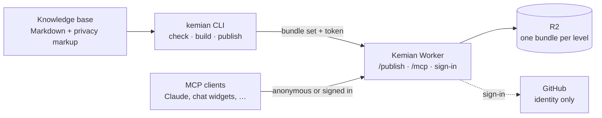

# Kemian

Serve one Markdown knowledge base to different audiences over MCP. Private content is marked inline, the bundler builds a redacted bundle per access level, and the server serves each caller only the bundle their credential maps to.

The name is 刻面 (_kèmiàn_), the gemology term for "facet": one body of knowledge, a different face for each viewer.

**Status:** the MVP works and is tested locally; nothing is deployed yet. Progress, next steps, open questions, and known gaps are in the [roadmap](docs/roadmap.md).

## Architecture

Redaction happens in the CLI, before anything leaves the author's machine or CI. The server only ever holds bundles, and each request sees exactly one level's bundle.

## Vocabulary

Terms used across the codebase, each defined in full where it's owned:

- **Level**: a named access level, such as `public`. Levels are an ordered list; each sees what the levels below it see. See [`protocol`](packages/server/src/protocol/README.md).
- **Privacy markup**: frontmatter `visibility` and tags named after levels that say what each level may see. See the [spec](docs/privacy-markup.md).
- **Bundle**: everything one level may see from one build, already redacted. **Bundle set**: every level's bundle from one build, published and replaced together. See [`protocol`](packages/server/src/protocol/README.md).
- **Search index**: a prebuilt index of one bundle's files, shipped inside it. See [`search`](packages/server/src/search/README.md).
- **Identity**: who a caller is, like `github:12345`, mapped to a level by configuration. **Sign-in provider**: what establishes an identity. See [`core`](packages/server/src/core/README.md).
- **Module**: one folder of `packages/server/src`, with its own export and import rules. See the [source overview](packages/server/src/README.md).

## Components

| Directory                                            | Purpose                                                                                  | Status  |
| ---------------------------------------------------- | ---------------------------------------------------------------------------------------- | ------- |
| [packages/server](packages/server/README.md)         | `@kemian/server`: the CLI, bundler, server, and Cloudflare Worker. Use Kemian from here. | working |
| [packages/server/src](packages/server/src/README.md) | Its six modules and how a request flows through them.                                    | working |
| [apps/demo](apps/demo/README.md)                     | A Worker serving the fixture knowledge base, with the end-to-end tests.                  | working |
| [fixtures](fixtures/README.md)                       | The invented knowledge base used by tests and the demo.                                  | stable  |
| [docs/design.md](docs/design.md)                     | Decisions and their reasons.                                                             |         |
| [docs/privacy-markup.md](docs/privacy-markup.md)     | The privacy markup spec.                                                                 |         |
| [docs/roadmap.md](docs/roadmap.md)                   | Milestones, next steps, open questions, and known gaps.                                  |         |
| [.claude/rules](.claude/rules/)                      | How to work in this repository: tooling, coding, documentation, privacy, tests.          |         |

## First Deployment

The first deployment is the author's personal knowledge base, a private repository at `~/projects/mindspace`. It may be read for context, following its own `AGENTS.md`: why Kemian exists (`ideas/kemian.md`), its markup spec (`meta/privacy-markup.md`), and its original exporter (`scripts/export-public.mjs`). Its content never enters this repository, which is public.

## License

[Apache-2.0](LICENSE).
