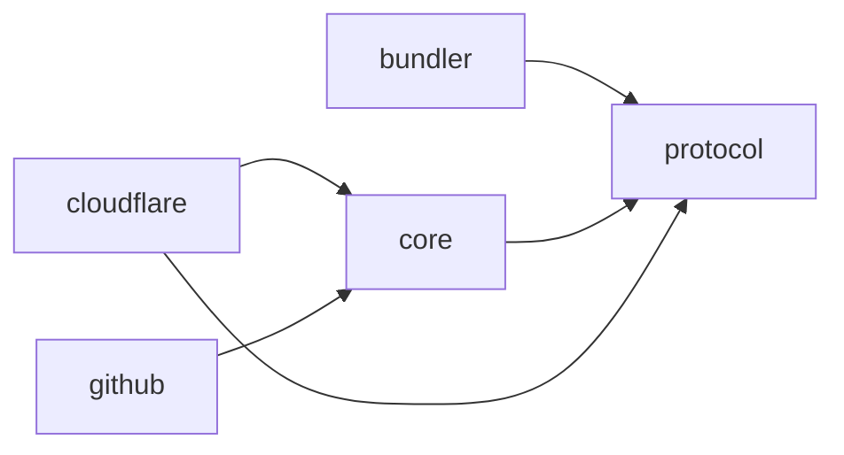

# Source overview

`@kemian/server` is one package split into five modules. Each module is a folder with an `index.ts` barrel, exported as a subpath (`@kemian/server/core`, …), so it can become its own package later. About 2,500 lines without tests.



| Module                      | Runs on       | In one sentence                                                                      |
| --------------------------- | ------------- | ------------------------------------------------------------------------------------ |
| [`protocol`](protocol/)     | anywhere      | The bundle format: schemas, types, the version check, and the JSON Schema.           |
| [`bundler`](bundler/)       | Node          | Turns a folder of Markdown into one bundle per level, plus the `kemian` CLI.         |
| [`core`](core/)             | any Fetch API | The server: storage interface, publishing, access levels, search, and the MCP tools. |
| [`cloudflare`](cloudflare/) | Workers       | Wires `core` into a Worker: routing, R2 storage, and the OAuth server for sign-in.   |
| [`github`](github/)         | any Fetch API | Signs people in with GitHub and turns them into identities like `github:12345`.      |

Oxlint enforces the arrows: a module imports another only through its `index.ts`, and only in the directions above. `protocol` and `core` can't import `node:*`, so they run in Workers.

## The four flows

Everything the code does is one of these. Each step names the function to read.

### 1. Build: Markdown to bundle set (`bundler`)

```
kemian.config.ts ─▶ loadConfig ─▶ resolveConfig ─▶ readSourceTree ─▶ buildBundleSetFromTree ─▶ BundleSet + problems
```

1. [`loadConfig`](bundler/bundler.ts) imports the config file (Node strips its types), and [`resolveConfig`](bundler/config.ts) validates it and fills in defaults.
2. [`readSourceTree`](bundler/source-tree.ts) reads every file under the root, skipping dot files and `node_modules`.
3. [`buildBundleSetFromTree`](bundler/bundle-set-build.ts) is the heart, in three passes over the included files:
   - **Analyze** each file: [`splitFrontmatter`](bundler/frontmatter.ts), then [`parseMarkup`](bundler/markup.ts) into a tree of lines, comments, spans, and blocks, then its level from [`VisibilityResolver`](bundler/visibility.ts) (own frontmatter, else the nearest folder `README.md`, else the default).
   - **Check links**: render the file for each level below the highest and flag links to anything that level can't see.
   - **Build each level's bundle**: keep files the level may see (and, below the highest level, only error-free ones), run the `filter` hook, render with [`renderMarkup`](bundler/markup.ts), and collect folders and instructions.
4. Problems carry a path, line, and severity. An error excludes the file below the highest level, and the CLI exits with 1.

The parser runs once per file, and rendering runs once per level. Everything a level must not see is decided in `renderMarkup`.

### 2. Publish: CLI to storage (`bundler` → `core` → `cloudflare`)

```
kemian publish ─▶ sendBundleSet ─PUT /publish─▶ Kemian.handlePublish ─▶ decodeBundleSet ─▶ BundleStore.replace
```

1. [`cli.ts`](bundler/cli.ts) builds (refusing on errors) and [`sendBundleSet`](bundler/publish.ts) PUTs the JSON with the bearer token.
2. [`handlePublish`](core/kemian.ts) compares the token in constant time, validates the body with [`decodeBundleSet`](protocol/protocol-version.ts) (unknown protocol versions are refused), and calls `replace`.
3. [`r2BundleStore`](cloudflare/bundle-store.r2.ts) writes the build's bundles, then switches `current.json` to it, keeping the previous build for readers still using it.

### 3. Serve: an MCP request (`cloudflare` → `core`)

```
Worker fetch ─▶ (sign-in needed?) ─▶ OAuthProvider ─▶ identity ─▶ Kemian.handleMcp ─▶ resolveLevel ─▶ ReaderCache ─▶ buildMcpServer
```

1. [`kemian()`](cloudflare/worker.ts) is the Worker's default export. It builds the options once per environment and routes:
   - `/publish` to publishing;
   - `/mcp` without a token or `?access=` straight to `core` with no identity, so it gets the anonymous level;
   - everything else, when sign-in is configured, through the OAuth server in [`oauth.ts`](cloudflare/oauth.ts). That server checks the token and hands `core` the identity stored at sign-in, and it also serves `/authorize`, `/callback`, `/token`, `/register`, and discovery.
2. [`handleMcp`](core/kemian.ts) resolves the level with [`resolveLevel`](core/access.ts) (403 if none) and gets a [`BundleReader`](core/bundle-reader.ts) from the reader cache, keyed by build ID and level.
3. It builds a fresh MCP server for the request with [`buildMcpServer`](core/mcp-server.ts): instructions for the level, the `list`, `read`, and `search` tools, and any tools from the `extend` hook. The MCP SDK's `createMcpHandler` then serves the request statelessly.
4. `BundleReader` answers the tools: folder listings from paths, reads by path, and a MiniSearch index built on the first search.

### 4. Sign-in: OAuth with GitHub behind it (`cloudflare` + `github`)

```
client ─▶ /authorize (consent) ─▶ GitHub ─▶ /callback ─▶ completeAuthorization ─▶ client ─▶ /token
```

[`oauth.ts`](cloudflare/oauth.ts) uses the Workers OAuth Provider's helpers. `showConsent` renders the consent page; `continueToSignIn` starts GitHub's flow with PKCE; `finishSignIn` exchanges the code through the [`SignInProvider`](core/sign-in.ts) (implemented by [`githubSignIn`](github/sign-in.ts)), refuses identities without a level, and completes the authorization with the identity as the token's props.

## Module guide

### `protocol`

| File                  | Contents                                                                        |
| --------------------- | ------------------------------------------------------------------------------- |
| `bundle.ts`           | `Bundle`, `BundleFile`, `BundleFolder`, `BuildInfo`, `Level`, and path schemas  |
| `bundle-set.ts`       | `BundleSet`, with the unique-level and same-build checks                        |
| `protocol-version.ts` | `decodeBundle`, `decodeBundleSet`, and their two errors                         |
| `json-schema.ts`      | Standalone JSON Schema documents, checked in at `../schema/` by a snapshot test |

Each schema is an Effect Schema constant with a type of the same name (`export const Bundle = …; export type Bundle = typeof Bundle.Type`). Regexes carry the `u` flag because Effect only exports `u` patterns to JSON Schema.

### `bundler`

| File                  | Contents                                                                                      |
| --------------------- | --------------------------------------------------------------------------------------------- |
| `config.ts`           | `KemianConfig` (the documented options), `defineConfig`, `resolveConfig`                      |
| `bundler.ts`          | `loadConfig`, `buildKnowledgeBase` (Effect), and `buildBundleSet` (Promise API)               |
| `source-tree.ts`      | `SourceTree`, read from disk or made from an object in tests                                  |
| `frontmatter.ts`      | YAML frontmatter, reporting malformed frontmatter instead of guessing                         |
| `markup.ts`           | The privacy markup: `parseMarkup` into a tree, `renderMarkup` for one level                   |
| `markdown.ts`         | Markdown scanning that markup and links share: code fences, inline code, links, first heading |
| `visibility.ts`       | `VisibilityResolver`: the level of a file or folder                                           |
| `bundle-set-build.ts` | `buildBundleSetFromTree`: the three passes                                                    |
| `problem.ts`          | `Problem`, formatting, and a collector that ignores duplicates                                |
| `publish.ts`          | `sendBundleSet`, the client side of `/publish`                                                |
| `cli.ts`              | `kemian check`, `build`, and `publish`, on `effect/cli`                                       |

`markup.ts` is the part to read most carefully. A line becomes `Text`, `Comment`, and `Span` parts; a block becomes a `Block` node. Rendering is a switch over those tags, so each rule about what a level sees is one `case`.

### `core`

| File                     | Contents                                                                           |
| ------------------------ | ---------------------------------------------------------------------------------- |
| `kemian.ts`              | `createKemian`: `handleMcp`, `handlePublish`, `resolveLevel`, and the reader cache |
| `mcp-server.ts`          | `buildMcpServer`: instructions, tools, their text output, and the `extend` hook    |
| `bundle-reader.ts`       | `BundleReader`: list, read, search; `normalizePath`                                |
| `access.ts`              | `Identity`, `AccessPolicy`, `makeAccessPolicy`, `resolveLevel`                     |
| `bundle-store.ts`        | The `BundleStore` interface (plain Promises) and `fromStore`                       |
| `bundle-store.memory.ts` | An in-memory store for tests and local use                                         |
| `sign-in.ts`             | The `SignInProvider` interface                                                     |

`core` works on web-standard `Request` and `Response`, so it runs anywhere with the Fetch API.

### `cloudflare`

| File                 | Contents                                                                          |
| -------------------- | --------------------------------------------------------------------------------- |
| `worker.ts`          | `kemian()`: options per environment, routing, CORS                                |
| `oauth.ts`           | `makeOAuthServer`: the OAuth provider, the consent page, and the sign-in handlers |
| `bundle-store.r2.ts` | `r2BundleStore`, against a minimal `R2BucketLike` so it's testable in Node        |

`oauth.ts` imports `cloudflare:workers` through the OAuth provider, so it only runs in `workerd`. `apps/demo` covers it with end-to-end tests.

### `github`

`sign-in.ts` builds GitHub's authorize URL and exchanges the code for the user. Its `fetch` and base URLs are injectable for tests.

## Conventions

- **Effect inside, Promises outside.** Exported entry points that deployers call (`buildBundleSet`, `createKemian`, `kemian()`, `BundleStore`, `githubSignIn`) are plain TypeScript. Effect appears where failures branch: decoding, config, the CLI, and the request handlers in `core/kemian.ts`, which end in `Effect.runPromise`. Pure logic, like the markup parser and the bundle reader, is plain TypeScript.
- **Expected errors are `Schema.TaggedError` classes**, caught by tag (`Effect.catchTags`) where they turn into responses or CLI messages. Impossible states throw.
- **Markup nodes are tagged unions on `_tag`**, like Effect's own, and switches over them end in `absurd`, so a new kind of node fails to compile until every switch handles it.
- **Relative imports end in `.ts`**, so Node runs the sources directly: `node src/bundler/cli.ts`.
- The rules behind these are in [`.claude/rules/`](../../../.claude/rules/).

## Tests

- **Next to the code** as `*.spec.ts`, run in Node: unit tests per file, plus `core/kemian.spec.ts`, which drives the server through the official MCP client.
- **Shared bundles** in [`../test/bundles.ts`](../test/bundles.ts), outside any module so every module can use them.
- **Packaging** in [`../test/package.spec.ts`](../test/package.spec.ts): builds, packs, and runs the packed package.
- **End to end** in [`apps/demo/test/`](../../../apps/demo/test/): the Worker in local `workerd`, publishing the fixture with the real CLI, reading it over MCP, and signing in against a fake GitHub.
- **Leak check**: `bundler/bundler.spec.ts` asserts that no private fact from the fixture appears in its public bundle.

## Where to start

1. Read [`protocol/bundle.ts`](protocol/bundle.ts) for what everything produces and consumes.
2. Run the CLI on the fixture and look at the output:
   ```sh
   cd fixtures/knowledge-base
   node ../../packages/server/src/bundler/cli.ts build -o /tmp/bundle-set.json
   ```
3. Read [`bundler/markup.ts`](bundler/markup.ts) with [`markup.spec.ts`](bundler/markup.spec.ts) beside it; the tests are the rules by example. Then [`bundle-set-build.ts`](bundler/bundle-set-build.ts).
4. Read [`core/kemian.ts`](core/kemian.ts), then [`mcp-server.ts`](core/mcp-server.ts) and [`bundle-reader.ts`](core/bundle-reader.ts).
5. Run the demo (`pnpm exec nx dev demo`), publish the fixture to it (`KEMIAN_PUBLISH_TOKEN=local-publish-token node packages/server/src/bundler/cli.ts publish --url http://localhost:5173` from the fixture folder), and point an MCP client at `/mcp`.
6. Read [`cloudflare/worker.ts`](cloudflare/worker.ts), then [`oauth.ts`](cloudflare/oauth.ts) with [`apps/demo/test/sign-in.spec.ts`](../../../apps/demo/test/sign-in.spec.ts), which walks the whole sign-in flow step by step.
