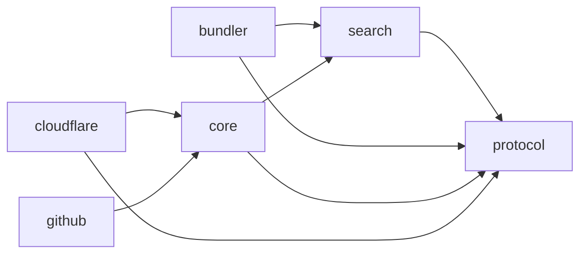

# Source Overview

`@kemian/server` is one package split into six modules. Each module is a folder with an `index.ts` barrel, exported as a subpath (`@kemian/server/core`, …), so it can become its own package later. Each has its own `README.md` with its files, status, and known gaps.



| Module                               | Runs on       | In one sentence                                                                    |
| ------------------------------------ | ------------- | ---------------------------------------------------------------------------------- |
| [`protocol`](protocol/README.md)     | anywhere      | The bundle format: schemas, types, the version check, and the JSON Schema.         |
| [`search`](search/README.md)         | anywhere      | The search index: built by the bundler, shipped in bundles, loaded by the server.  |
| [`bundler`](bundler/README.md)       | Node          | Turns a folder of Markdown into one bundle per level, plus the `kemian` CLI.       |
| [`core`](core/README.md)             | any Fetch API | The server: storage interfaces, publishing, access levels, and the MCP tools.      |
| [`cloudflare`](cloudflare/README.md) | Workers       | Wires `core` into a Worker: routing, R2 storage, and the OAuth server for sign-in. |
| [`github`](github/README.md)         | any Fetch API | Signs people in with GitHub and turns them into identities like `github:12345`.    |

Oxlint enforces the arrows: a module imports another only through its `index.ts`, and only in the directions above. `protocol`, `search`, `core`, and `github` can't import `node:*`, so they run in Workers.

## The Five Flows

Everything the code does is one of these. Each step names the function to read.

### 1. Build: Markdown to Bundle Set (`bundler`)

```
kemian.config.ts ─▶ loadConfig ─▶ resolveConfig ─▶ readSourceTree ─▶ buildBundleSetFromTree ─▶ BundleSet + problems
```

1. [`loadConfig`](bundler/bundler.ts) imports the config file (Node strips its types), and [`resolveConfig`](bundler/config.ts) validates it and fills in defaults.
2. [`readSourceTree`](bundler/source-tree.ts) reads every file under the root, skipping dot files, `node_modules`, and whatever `.gitignore` files under the root ignore.
3. [`buildBundleSetFromTree`](bundler/bundle-set-build.ts) is the heart, in three passes over the included files:
   - **Analyze** each file: [`splitFrontmatter`](bundler/frontmatter.ts), then [`parseMarkup`](bundler/markup.ts) into a tree of lines, comments, spans, and blocks, then its level from [`VisibilityResolver`](bundler/visibility.ts) (own frontmatter, else the nearest folder `README.md`, else the default).
   - **Check links**: render the file for each level that gets it and flag links to anything outside that level's bundle: more restricted, filtered out, left out for errors, excluded, or missing.
   - **Build each level's bundle**: keep files the level may see (and, below the highest level, only error-free ones), run the `filter` hook, render with [`renderMarkup`](bundler/markup.ts), collect folders and instructions, and index the bundle's own files with [`buildSearchIndex`](search/search-index.ts).
4. Problems carry a path, line, and severity. An error excludes the file below the highest level, and the CLI exits with 1.

The parser runs once per file, and rendering runs once per level. Everything a level must not see is decided in `renderMarkup`.

### 2. Publish: CLI to Storage (`bundler` → `core` → `cloudflare`)

```
kemian publish ─▶ sendBundleSet ─PUT /publish─▶ Kemian.handlePublish ─▶ decodeBundleSet ─▶ BundleStore.replace
```

1. [`cli.ts`](bundler/cli.ts) builds (refusing on errors) and [`sendBundleSet`](bundler/publish.ts) PUTs the JSON with the bearer token.
2. [`handlePublish`](core/kemian.ts) compares the token in constant time, validates the body with [`decodeBundleSet`](protocol/protocol-version.ts) (unknown protocol versions are refused), and calls `replace`.
3. [`r2BundleStore`](cloudflare/bundle-store.r2.ts) writes the build's bundles, then switches `current.json` to it, keeping the previous build for readers still using it.

### 3. Serve: An MCP Request (`cloudflare` → `core`)

```
Worker fetch ─▶ (sign-in needed?) ─▶ OAuthProvider ─▶ identity ─▶ Kemian.handleMcp ─▶ resolveLevel ─▶ ReaderCache ─▶ buildMcpServer
```

1. [`kemian()`](cloudflare/worker.ts) is the Worker's default export. It builds the options once per environment and routes:
   - `/publish` to publishing;
   - `/mcp` without a token or `?access=` straight to `core` with no identity, so it gets the anonymous level;
   - everything else, when sign-in is configured, through the OAuth server in [`oauth.ts`](cloudflare/oauth.ts). That server checks the token and hands `core` the identity stored at sign-in, and it also serves `/authorize`, `/callback`, `/token`, `/register`, and discovery.
2. [`handleMcp`](core/kemian.ts) resolves the level with [`resolveLevel`](core/access.ts) (403 if none) and gets a [`BundleReader`](core/bundle-reader.ts) from the reader cache, keyed by build ID and level.
3. It builds a fresh MCP server for the request with [`buildMcpServer`](core/mcp-server.ts): instructions for the level, the `list`, `read`, and `search` tools, and any tools from the `extend` hook. The MCP SDK's `createMcpHandler` then serves the request statelessly.
4. `BundleReader` answers the tools: folder listings from paths, reads by path, and searches through [`loadSearchIndex`](search/search-index.ts), which loads the bundle's prebuilt index on the first search or builds one when the bundle has none.

### 4. Sign-In: OAuth With GitHub Behind It (`cloudflare` + `github`)

```
client ─▶ /authorize (consent) ─▶ GitHub ─▶ /callback ─▶ completeAuthorization ─▶ client ─▶ /token
```

[`oauth.ts`](cloudflare/oauth.ts) uses the Workers OAuth Provider's helpers. `showConsent` renders the consent page; `continueToSignIn` starts GitHub's flow with PKCE; `finishSignIn` exchanges the code through the [`SignInProvider`](core/sign-in.ts) (implemented by [`githubSignIn`](github/sign-in.ts)), refuses identities without a level, and completes the authorization with the identity as the token's props.

### 5. Edit: Agent to Pull Request (`core` → `cloudflare` → `bundler`)

```
editing tool ─▶ ProposalStore (R2) ◀─GET /proposals─ kemian proposals pull ─▶ GitHub: branch, pull request, status
```

1. [`handleMcp`](core/kemian.ts) gives an editor at the highest level (the bundle says `highest`) the tools in [`editing-tools.ts`](core/editing-tools.ts). Each checks its input against the caller's bundle, e.g. that edits apply with [`applyTextEdits`](protocol/proposal.ts), and adds a [`Proposal`](protocol/proposal.ts) to the [`ProposalStore`](core/proposal-store.ts), within the daily limit.
2. [`r2ProposalStore`](cloudflare/proposal-store.r2.ts) keeps each pending proposal as one object, plus a record per identity and day for the limit and retries. The Worker routes `/proposals` to [`handleProposals`](core/kemian.ts), which checks the proposals token.
3. [`pullProposals`](bundler/proposal-pull.ts) fetches the queue and, for each proposal, [`applyProposal`](bundler/proposal-apply.ts) changes the source (or writes a note when it conflicts), [`reviewChanges`](bundler/proposal-review.ts) builds the bundle set before and after, and [`makeGitHubRepository`](bundler/github-repository.ts) commits, opens the pull request, and posts the `kemian/check` status. It acknowledges each proposal once it's handled.

## Conventions

- **Effect inside, Promises outside.** Exported entry points that deployers call (`buildBundleSet`, `createKemian`, `kemian()`, `BundleStore`, `githubSignIn`) are plain TypeScript. Effect appears where failures branch: decoding, config, the CLI, and the request handlers in `core/kemian.ts`, which end in `Effect.runPromise`. Pure logic, like the markup parser and the bundle reader, is plain TypeScript.
- **Expected errors are `Schema.TaggedError` classes**, caught by tag (`Effect.catchTags`) where they turn into responses or CLI messages. Impossible states throw.
- **Markup nodes are tagged unions on `_tag`**, like Effect's own, and switches over them end in `absurd`, so a new kind of node fails to compile until every switch handles it.
- **Relative imports end in `.ts`**, so Node runs the sources directly: `node src/bundler/cli.ts`.

## Tests

- **Next to the code** as `*.spec.ts`, run in Node: unit tests per file, plus `core/kemian.spec.ts` and `core/editing-tools.spec.ts`, which drive the server through the official MCP client.
- **Shared test code** in [`../test/`](../test/), outside any module so every module can use it: bundles, the `ProposalStore` contract both stores pass, and a fake GitHub.
- **Editing end to end** in [`../test/editing.spec.ts`](../test/editing.spec.ts): an editor proposes through the MCP tools, then the real CLI pulls the proposals over HTTP into pull requests on the fake GitHub.
- **Packaging** in [`../test/package.spec.ts`](../test/package.spec.ts): builds, packs, and runs the packed package.
- **End to end** in [`apps/demo/test/`](../../../apps/demo/test/): the Worker in local `workerd`, publishing the fixture with the real CLI, reading it over MCP, and signing in against a fake GitHub.
- **Leak check**: `bundler/bundler.spec.ts` asserts that no private fact from the fixture appears in its public bundle, search index included.

## Where to Start

1. Read [`protocol/bundle.ts`](protocol/bundle.ts) for what everything produces and consumes.
2. Run the CLI on the fixture and look at the output:
   ```sh
   cd fixtures/knowledge-base
   node ../../packages/server/src/bundler/cli.ts build -o /tmp/bundle-set.json
   ```
3. Read [`bundler/markup.ts`](bundler/markup.ts) with [`markup.spec.ts`](bundler/markup.spec.ts) beside it; the tests are the rules by example. Then [`bundle-set-build.ts`](bundler/bundle-set-build.ts).
4. Read [`core/kemian.ts`](core/kemian.ts), then [`mcp-server.ts`](core/mcp-server.ts) and [`bundle-reader.ts`](core/bundle-reader.ts).
5. Run the demo (`pnpm exec nx dev demo`), publish the fixture to it (`KEMIAN_PUBLISH_TOKEN=local-publish-token node packages/server/src/bundler/cli.ts publish --url http://localhost:5173` from the fixture folder), and point an MCP client at `/mcp`.
6. Read [`cloudflare/worker.ts`](cloudflare/worker.ts), then [`oauth.ts`](cloudflare/oauth.ts) with [`apps/demo/test/sign-in.spec.ts`](../../../apps/demo/test/sign-in.spec.ts), which walks the whole sign-in flow step by step.
